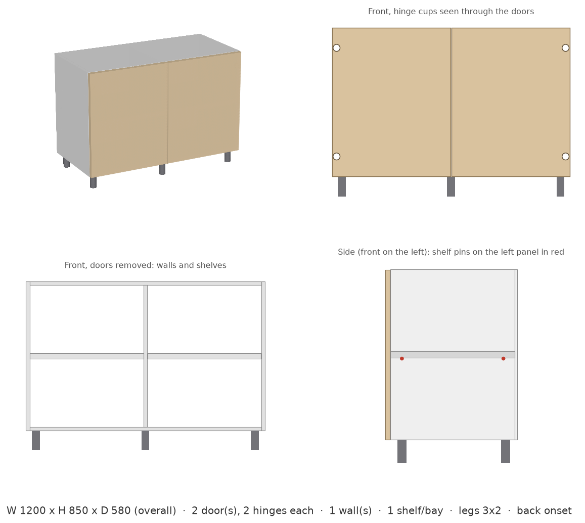
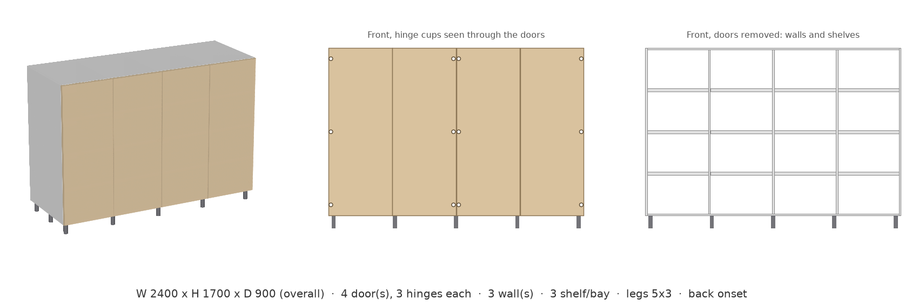

# param-cabinet

**AI가 만드는 파라메트릭 하부장** — 고객 문장 한 줄로 주방 하부장의 파라메트릭 CAD 모델(CadQuery 코드)을 생성하고, 크기를 바꿔도 설계 규칙이 유지되는지 자동으로 채점하는 실험입니다.

*AI-generated parametric CAD for a kitchen base cabinet, scored on whether its design rules still hold when the size changes.*

- **최신 결과물 (3D, 브라우저에서 바로 조작):** https://goyodsgn.github.io/param-cabinet/
- **포트폴리오 글:** [AI 파라메트릭 하부장 연구 - 최신 업데이트](https://jeongyeon.framer.website/project/ai-parametric-cabinet-live) · [연구 과정](https://jeongyeon.framer.website/project/ai-parametric-cabinet) · [English](https://jeongyeon.framer.website/en/project/ai-parametric-cabinet)
- **만든 사람:** 김정연 (Jeongyeon Kim), computational designer — https://jeongyeon.framer.website

## 결과 요약

| 실험 | 질문 | 결과 | 상세 |
| --- | --- | --- | --- |
| 1. 치수 해석 | 고객이 다양하게 말해도 치수를 제대로 읽는가 | 10건 모두 통과 | [results/step3.md](results/step3.md) |
| 2. 우선순위 | 고객 요청과 제작 규칙이 충돌하면 규칙대로 처리하는가 | 12건 모두 통과 | [results/step3_priority.md](results/step3_priority.md) |
| 3. 크기 변경 | 생성된 모델에 다른 크기를 넣어도 규칙이 유지되는가 | 638번 중 628번(98%) 통과 | [results/step4.md](results/step4.md) |
| 4. 대화형 요청 | 두 번에 나눠 요청해도(외경·내경, 문 배치, 싱크대, 상판·뒷판 방식) 제대로 반영하는가 | 대화 24개 × 2턴 모두 통과 | [results/chat.md](results/chat.md) |

실험 3에서 실패한 2개 모델은 문이 3짝일 때 마지막 문의 경첩을 반대쪽에 다는 같은 오류를 보였습니다. 고객이 요청한 크기에서는 문이 짝수여서 실험 2에서는 드러나지 않았습니다.

## 생성 예시

같은 모델에 크기만 바꿔 넣은 결과입니다. 왼쪽 위 3D, 오른쪽 위 정면(동그라미 = 힌지), 왼쪽 아래 문을 뗀 내부, 오른쪽 아래 측면(빨간 점 = 선반 받침).




다른 크기: [previews/](previews/) · 크기별 규칙 검사: [previews/summary.txt](previews/summary.txt)

## 작동 방식

1. **기준 모델** — 하부장 규칙을 모두 반영해 사람이 직접 작성한 정답 모델
2. **생성** — Claude(Sonnet 5.5)에게 규칙 문서와 고객 문장을 주고 CadQuery 코드를 작성하게 함
3. **채점** — 생성된 코드를 실행해 형상을 만들고 12개 항목(외곽 크기, 문 개수, 도어갭, 힌지 개수·방향, 내부 벽, 선반, 선반 받침, 다리 등)을 기준 모델과 비교
4. **크기 변경 테스트** — 같은 코드에 크기 30가지(경계값 포함)를 넣어 매번 다시 채점

모든 단계는 GitHub Actions에서 자동 실행됩니다.

## 폴더 구조

| 경로 | 내용 |
| --- | --- |
| `cabinet_reference.py` | 기준(정답) 모델 |
| `prompts/system.md` | AI에게 주는 설계 규칙 전체 |
| `experiment/` | 테스트 문장(`sentences*.csv`), 생성·채점·크기 변경 테스트 스크립트 |
| `generated/`, `generated_priority/` | AI가 생성한 CadQuery 코드 (실험 1, 2) |
| `results/` | 실험별 채점 결과 |
| `previews/` | 기준 모델 미리보기 이미지 |
| `render.py` | 미리보기 이미지 렌더러 |
| `tests/` | 기준 모델 테스트 |
| `.github/workflows/` | CI(`ci.yml`), 생성 실험(`experiment.yml`), 크기 변경 테스트(`robustness.yml`) |

## 직접 실행

```bash
pip install -r requirements.txt
pytest                                  # 기준 모델 테스트
python experiment/robustness.py         # 크기 변경 테스트
```

생성 실험(`experiment/generate.py`)은 `ANTHROPIC_API_KEY` 환경 변수가 필요합니다.

## 사용 도구

Python · [CadQuery](https://github.com/CadQuery/cadquery) · Claude API · GitHub Actions
