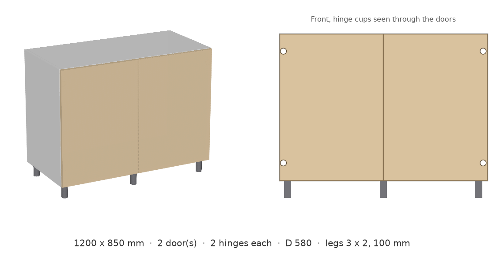
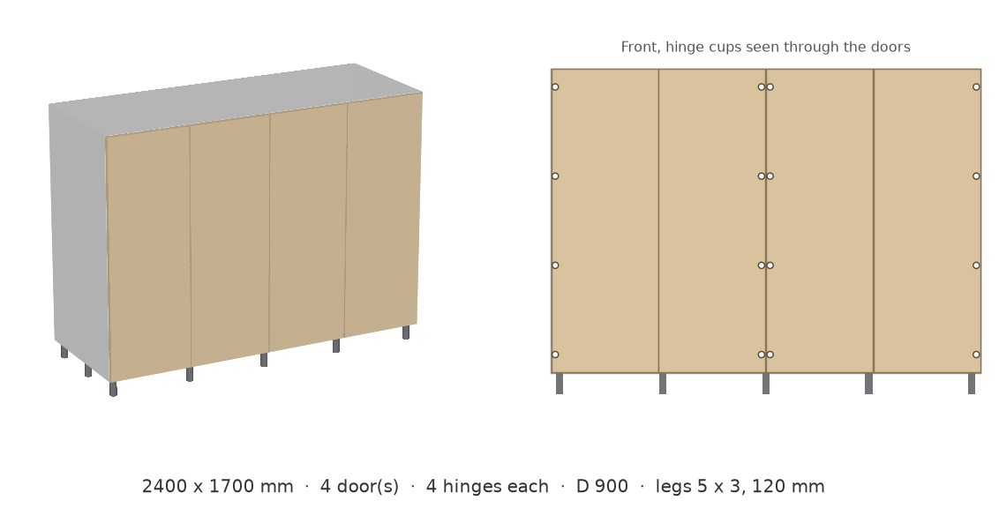

# param-cabinet

AI-generated parametric CAD: a base cabinet whose doors and hinges follow size rules.

Work in progress. Step 1 is the hand-written reference model (`cabinet_reference.py`):
change width and height, and the number of doors and hinges follows the rules.

W, D, H are the overall bounding box (doors and legs included). Full rule list: `prompts/system.md`.

| Rule | Default |
| --- | --- |
| Doors | overlay, one more per 600 mm of width, 2 mm gap on every side and in front of the carcass |
| Door hinge sides | facing pairs (L R L R ...); an odd last door hinges right |
| Hinges per door | 2 up to 900 mm door height, 3 up to 1600 mm, 4 above |
| Inner walls | one behind every joint between two doors |
| Shelves | as many as keep every space at least 320 mm high, on 4 shelf pins each |
| Back panel | onset (default) or inset |
| Thickness | panels 18, back 10, walls 18, doors 22, shelves 30 |
| Legs | corners with a 30 mm margin, middle legs added so spacing stays within 600 mm |

Every push runs the tests on GitHub Actions and builds sample cabinets (STEP, STL, SVG)
as a downloadable artifact.

## Preview

Rule check results for each size: [previews/summary.txt](previews/summary.txt)
